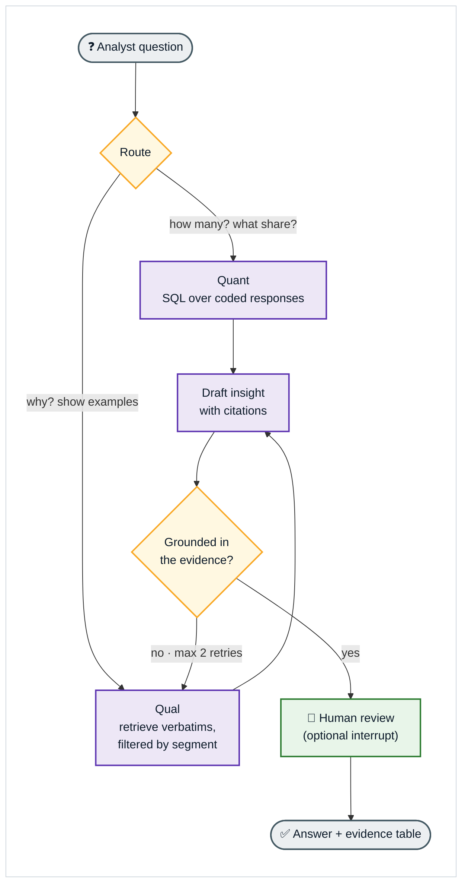
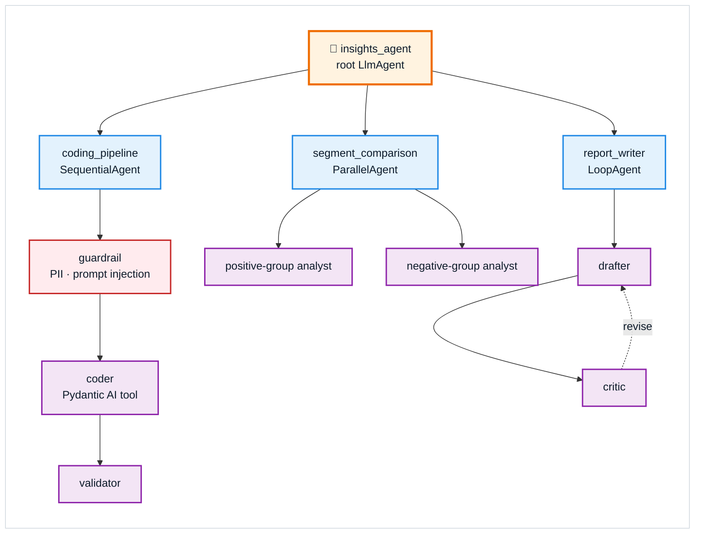
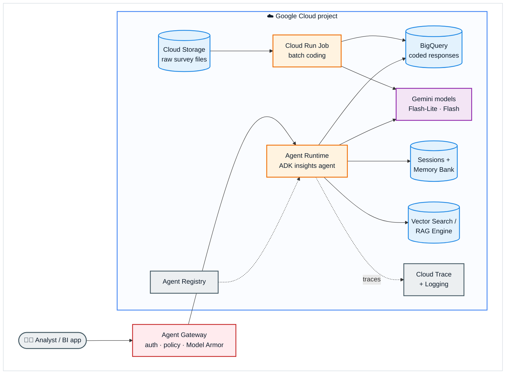
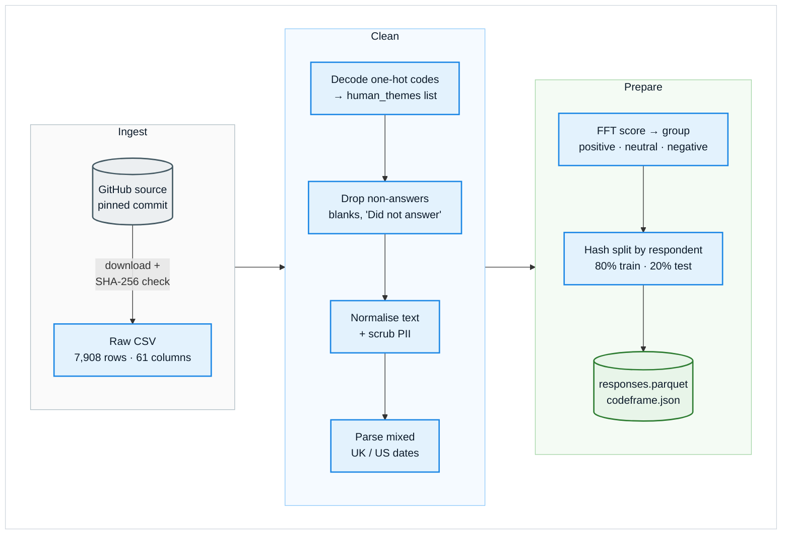

# Verbatim: AI agents for open-ended survey analysis

> Turning thousands of free-text survey answers into coded themes and evidence-backed insights,
> with agents that are evaluated against human coders and built to run on Google Cloud.


---

## The problem

Almost every customer-experience survey ends with an open question: *"Why did you give that
score?"* Research teams then **code** those verbatims by hand against a codeframe (a fixed list of
themes) before anyone can answer the questions that matter, like *"why are unhappy customers of
service X unhappy?"*.

Hand-coding is slow, expensive and inconsistent between coders. LLMs can do most of it, but a
production system has to answer harder questions than "does the demo work?":

- How closely does the model agree with trained human coders, and on which themes does it fail?
- Respondents can type anything. How do we stop their text from steering the agent?
- How do we keep personal data out of prompts, logs and vector stores?
- What does it cost per 10,000 responses, and how does it scale to a million?
- How do we deploy, monitor and change it without breaking things?

This project builds that system step by step on real survey data.

## What it builds

| # | Component | What it does |
|---|-----------|--------------|
| 1 | **Coding agent** | Assigns codeframe themes and sentiment to each verbatim. Output is typed and validated, and scored against human coders. |
| 2 | **Insights agent** | Answers analyst questions by combining numbers ("what share of negative comments mention waiting times?") with retrieved verbatims as evidence. |
| 3 | **Evaluation harness** | Measures coding agreement, retrieval quality, answer groundedness and agent behaviour, and gates releases on it. |
| 4 | **GCP deployment** | Agent Runtime, BigQuery and Vector Search, with guardrails, tracing and access control. |

---

## The data

Real responses to the **NHS Friends and Family Test (FFT)**, the UK health service's standard
patient-experience survey. It has the same shape as an NPS survey in market research: a closed
rating question followed by an open "why?".

What makes it a good portfolio dataset is that **every answer was coded by trained human coders**
against a 50-theme codeframe. That gives a gold standard to evaluate the LLM coder against, which
most public text datasets do not have.

| | |
|---|---|
| **Source** | [pxtextmining](https://github.com/The-Strategy-Unit/pxtextmining) (The Strategy Unit / NHS England), MIT licence |
| **Organisations** | North East Ambulance Service (NEAS), Northamptonshire Healthcare (NHFT) |
| **Period** | January 2021 to December 2022 |
| **Size** | 7,908 raw answers; 6,205 usable after removing blanks and "Did not answer" |
| **Respondents** | 4,129 with a usable answer; about half answered two questions |
| **Closed question** | FFT rating, 1 = very good … 5 = very poor |
| **Open questions** | "What was good?", "What could we do better?", "FFT Why?", … |
| **Human labels** | Multi-label themes from a [50-code framework](https://the-strategy-unit.github.io/PatientExperience-QDC/framework/framework3.html), plus a 1–5 sentiment score |
| **Segments** | Trust, service (patient transport, 111, mental health, …), date |

A few verbatims, as written by respondents:

> *"Staff were lovely but ambulance door was falling off."*
> *"Maybe a few more checks on the first visit, my dad couldn't even get to the toilet…"*

It is also realistically messy. 80% of answers come from satisfied respondents, the theme
distribution is long-tailed (a handful of themes cover most answers, several have almost no
examples), dates mix UK and US formats, and a few blank answers were still given a theme.

---

## Architecture


### Where each tool fits

Each framework is used where it is strongest, so the trade-offs are visible. In a team codebase I
would standardise on fewer.

| Tool | Role here | Why this tool for this job |
|------|-----------|----------------------------|
| **Pydantic AI** | Coding agent | Type-safe structured output, validators that reject themes outside the codeframe, automatic retries, model-agnostic |
| **LangChain** | Embeddings, vector stores, hybrid retrieval | Mature integrations (Vertex AI, Chroma, BM25); swap the store without rewriting retrieval code |
| **LangGraph** | Analyst workflow: route → retrieve → check → review | Explicit state machine, conditional loops with limits, checkpointing, human-in-the-loop interrupts |
| **Google ADK** | Deployable insights agent | Workflow agents (sequential, parallel, loop), sub-agents, sessions and Memory Bank, eval sets, deploys to Agent Runtime |
| **Google Cloud** | Storage, warehouse, serving | BigQuery, Cloud Storage, Vector Search, Agent Runtime, Cloud Run, IAM |

---

## Agent design (planned)

### Analyst workflow (LangGraph)



### Insights agent (Google ADK)



---

## Evaluation

The human codes are split by respondent, so the test set measures performance on people the
system has never seen. Every step ships with its own metric, and step 6 turns them into one
harness that runs in CI.


---

## Built for production

| Concern | How the project handles it | Step |
|---------|----------------------------|------|
| **Untrusted input** | Verbatims are written by the public. They are delimited as data in prompts, screened for injection attempts, and the agent can only call allow-listed tools. Model Armor in production. | 2, 7 |
| **Privacy** | PII is masked before text reaches an LLM, a log or a vector store. Sensitive Data Protection for names in production. | 1, 7 |
| **Evaluation** | Gold human labels, respondent-level holdout, per-theme agreement, ADK eval sets, rubric-based autoraters. | 2–6 |
| **Control** | Closed codeframe, typed outputs with validators, bounded loops, human approval on reports. | 2, 4 |
| **Scalability** | Batch coding with bounded concurrency, retries and caching by text hash; Cloud Run Jobs and BigQuery for volume. | 2, 7 |
| **Cost** | Small fast model for high-volume coding, larger model only for analysis; token usage tracked per run. | 2, 6 |
| **Model choice** | Gemini Flash-Lite vs Flash vs open-weights Gemma, compared on the gold set for quality, latency and cost. | 6 |
| **Memory** | Short-term sessions vs long-term Memory Bank (e.g. an analyst's preferred segments). | 5 |
| **Observability** | OpenTelemetry traces for every model and tool call, exported to Cloud Trace. | 7 |
| **Interoperability** | The insights agent exposed over A2A; data tools exposed over MCP. | 7 |

### Target deployment on Google Cloud



| Deployment target | Choose it when |
|-------------------|----------------|
| **Agent Runtime** | It is an ADK agent and you want managed sessions, Memory Bank, scaling and tracing with the least ops work. |
| **Cloud Run** | You need your own API around the agent, a different framework, or scale-to-zero containers you fully control. |
| **GKE** | You already run on Kubernetes, or need GPUs and self-hosted models next to the agent. |

---

## Roadmap

| Step | Topic | Main tools | Status |
|------|-------|-----------|--------|
| 1 | Data foundation: download, clean, PII scrub, respondent-level split | pandas | ✅ Done |
| 2 | Verbatim coding with structured outputs, scored against human coders | Pydantic AI, Gemini | 🔜 Next |
| 3 | Retrieval: embeddings, hybrid search, metadata filters, reranking | LangChain, Chroma, Vertex AI | ⬜ |
| 4 | Analyst workflow with routing, grounding checks and human review | LangGraph | ⬜ |
| 5 | Insights agent with workflow agents, sessions and memory; deploy | Google ADK, Agent Runtime | ⬜ |
| 6 | Evaluation harness and model comparison | Gen AI evaluation service, ADK evalsets | ⬜ |
| 7 | Production hardening: guardrails, tracing, A2A / MCP, CI | Model Armor, Cloud Trace, GitHub Actions | ⬜ |

### Step 1: Data foundation ✅



Decisions worth calling out:

- **Reproducible input.** The source file is pinned to a commit and checked against a SHA-256 hash,
  so a silent upstream change cannot shift the results.
- **Mixed date formats, handled explicitly.** One export used US dates (`9/30/2022`) while the
  rest are UK (`30/09/2021`). Strict parsing surfaced it; the parser resolves it with a documented
  rule instead of letting pandas guess.
- **Split by respondent, not by row.** About half the respondents answered two questions. A
  row-level split could put one of a person's answers in train and the other in test, which
  inflates scores.
- **Hash-based split.** Assignment depends only on the respondent ID, so it stays stable when new
  survey waves are appended.
- **Gold labels are kept apart.** Human themes and sentiment live in `human_*` columns and are
  never sent to a model.
- **PII is masked first.** Everything downstream (prompts, logs, vector store) only sees scrubbed text.

---

## Project structure

```text
pydanticai-rag-langgraph-adk/
├── src/verbatim/
│   ├── config.py        settings from env / .env                   ✅
│   ├── data.py          step 1 · download, clean, split             ✅
│   ├── coding.py        step 2 · Pydantic AI coding agent           🔜
│   ├── retrieval.py     step 3 · LangChain indexing and retrieval   ⬜
│   ├── graph.py         step 4 · LangGraph analyst workflow         ⬜
│   ├── adk_agent/       step 5 · Google ADK agent and deployment    ⬜
│   └── evaluation.py    step 6 · metrics and eval runs              ⬜
├── tests/
│   └── test_data.py                                                 ✅
├── data/                created by step 1, not committed
├── pyproject.toml
└── README.md
```

## Quickstart

Requires [uv](https://docs.astral.sh/uv/) and Python 3.11+.

```bash
git clone https://github.com/ryan-backer-ds/pydanticai-rag-langgraph-adk.git
cd pydanticai-rag-langgraph-adk
uv sync

uv run python -m verbatim.data   # download and prepare the survey data
uv run pytest                    # run the tests
```

Step 1 writes two files to `data/processed/`:

- `responses.parquet`: one row per usable answer, with segments, FFT score, scrubbed text, human
  labels and a `split` column
- `codeframe.json`: the 49 codeable themes in framework order, with how often coders used each

## Data licence and attribution

The survey data is not stored in this repository. `verbatim.data` downloads it from
[The-Strategy-Unit/pxtextmining](https://github.com/The-Strategy-Unit/pxtextmining) (MIT licence),
pinned to commit `1f3ae76`. It contains Friends and Family Test feedback shared by North East
Ambulance Service and Northamptonshire Healthcare NHS Foundation Trust, labelled by the
Patient Experience Qualitative Data Categorisation project. Credit to The Strategy Unit and
NHS England for making it public.
