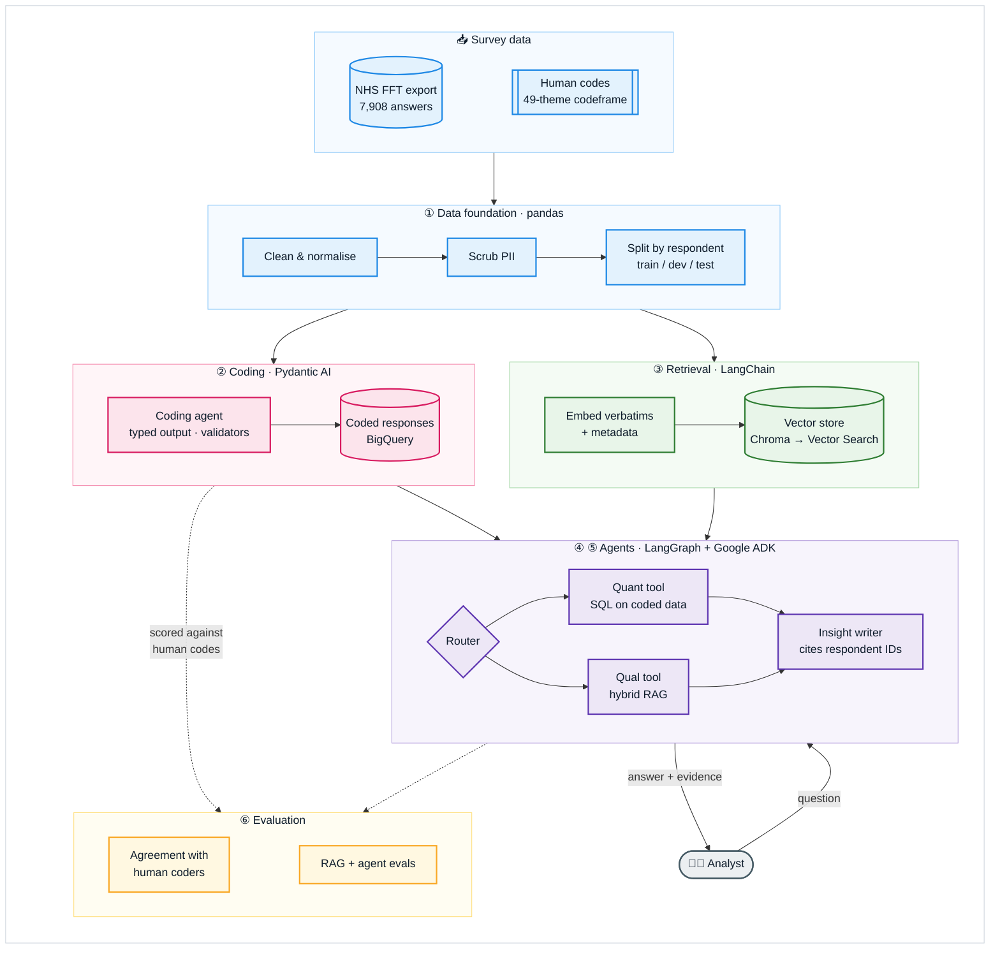
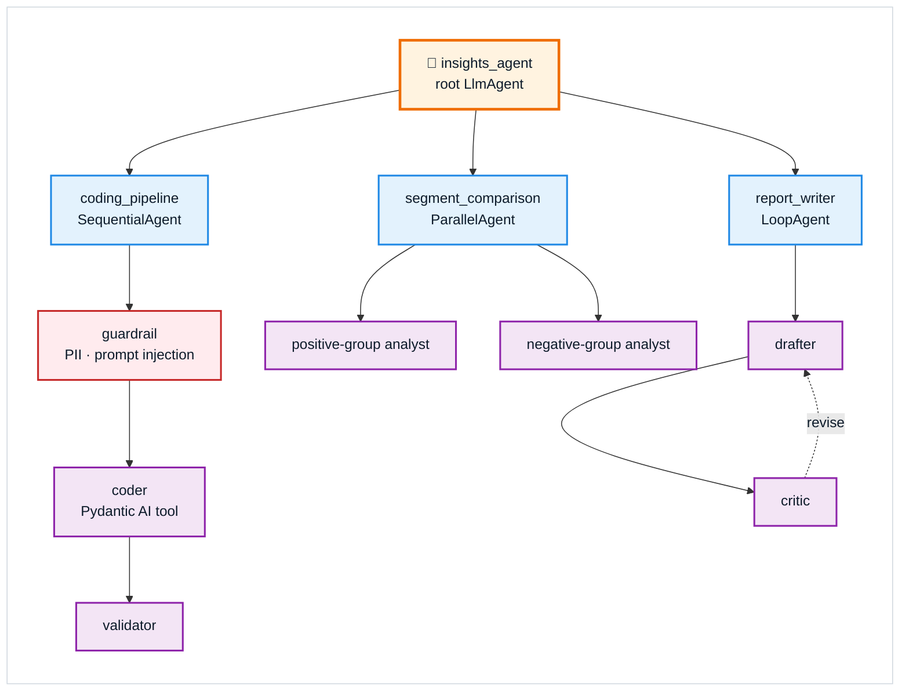
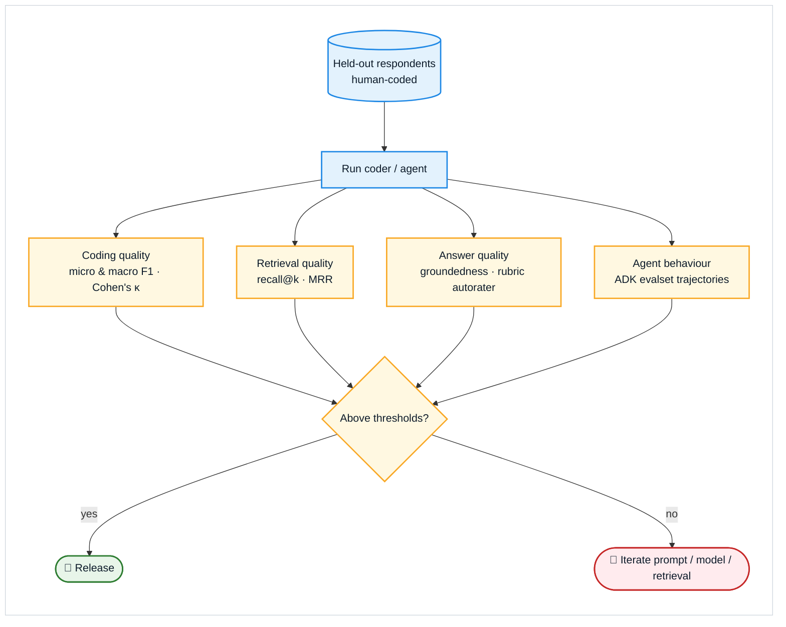
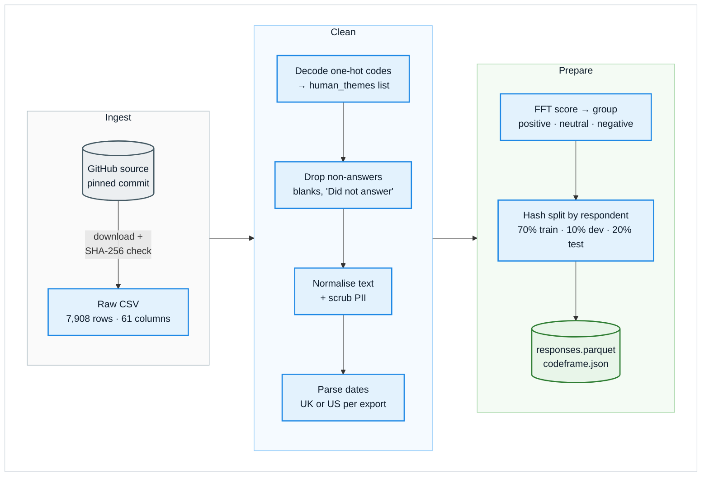
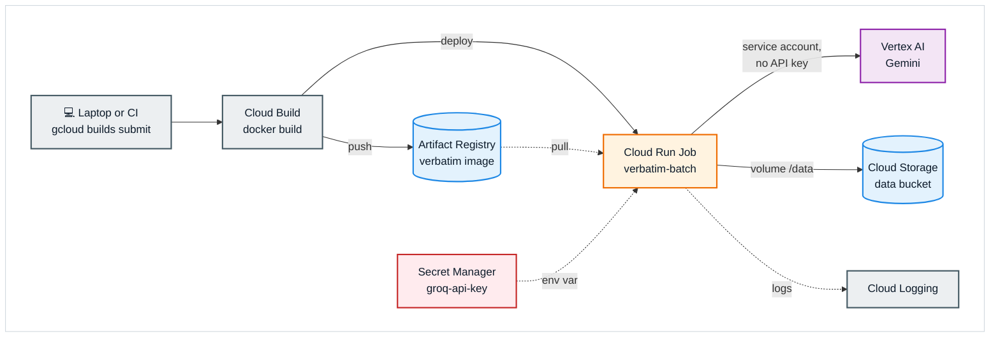
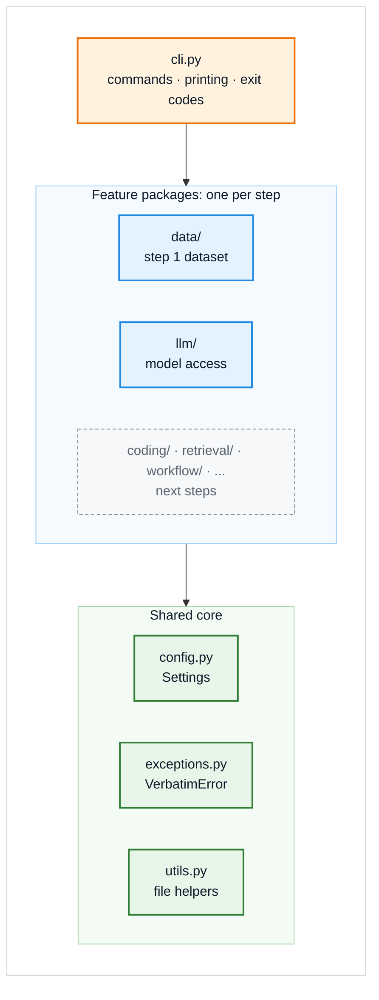

# Verbatim: AI agents for open-ended survey analysis

> Turning thousands of free-text survey answers into coded themes and evidence-backed insights,
> with agents that are evaluated against human coders and built to run on Google Cloud.


[](https://github.com/ryan-backer-ds/pydanticai-rag-langgraph-adk/actions/workflows/ci.yml)

---

## The problem

Almost every customer-experience survey ends with an open question: *"Why did you give that
score?"* Research teams then **code** those verbatims by hand against a codeframe (a fixed list of
themes) before anyone can answer the questions that matter, like *"why are unhappy customers of
service X unhappy?"*.

Hand-coding is slow, expensive and inconsistent between coders. LLMs can do most of it, but a
production system has to answer harder questions than "does the demo work?":

- How closely does the model agree with trained human coders, and on which themes does it fail?
- Respondents can type anything. How do we stop their text from steering the agent?
- How do we keep personal data out of prompts, logs and vector stores?
- What does it cost per 10,000 responses, and how does it scale to a million?
- How do we deploy, monitor and change it without breaking things?

This project builds that system step by step on real survey data.

## What it builds

| # | Component | What it does |
|---|-----------|--------------|
| 1 | **Coding agent** | Assigns codeframe themes and sentiment to each verbatim. Output is typed and validated, and scored against human coders. |
| 2 | **Insights agent** | Answers analyst questions by combining numbers ("what share of negative comments mention waiting times?") with retrieved verbatims as evidence. |
| 3 | **Evaluation harness** | Measures coding agreement, retrieval quality, answer groundedness and agent behaviour, and gates releases on it. |
| 4 | **GCP deployment** | Agent Runtime, BigQuery and Vector Search, with guardrails, tracing and access control. |

---

## The data

Real responses to the **NHS Friends and Family Test (FFT)**, the UK health service's standard
patient-experience survey. It has the same shape as an NPS survey in market research: a closed
rating question followed by an open "why?".

What makes it a good portfolio dataset is that **every answer was coded by trained human coders**
against a 49-theme codeframe. That gives a gold standard to evaluate the LLM coder against, which
most public text datasets do not have.

| | |
|---|---|
| **Source** | [pxtextmining](https://github.com/The-Strategy-Unit/pxtextmining) (The Strategy Unit / NHS England), MIT licence |
| **Organisations** | North East Ambulance Service (NEAS), Northamptonshire Healthcare (NHFT) |
| **Period** | April 2021 to September 2022 |
| **Size** | 7,908 raw answers; 6,211 usable after removing blanks and "Did not answer" |
| **Respondents** | 4,132 with a usable answer; about half answered two questions |
| **Closed question** | FFT rating, 1 = very good … 5 = very poor |
| **Open questions** | "What was good?", "What could we do better?", "FFT Why?", … |
| **Human labels** | Multi-label themes from a [50-code framework](https://the-strategy-unit.github.io/PatientExperience-QDC/framework/framework3.html) (49 themes plus "Labelling not possible" for blanks), and a 1–5 sentiment score, 1 = very positive |
| **Segments** | Trust, service (patient transport, 111, mental health, …), date |

A few verbatims, as written by respondents:

> *"Staff were lovely but ambulance door was falling off."*
> *"Maybe a few more checks on the first visit, my dad couldn't even get to the toilet…"*

It is also realistically messy. 80% of answers come from satisfied respondents, the theme
distribution is long-tailed (a handful of themes cover most answers, several have almost no
examples), one export wrote its dates in US format, and a dozen whitespace-only answers were
still coded.

---

## Architecture



### Where each tool fits

Each framework is used where it is strongest, so the trade-offs are visible. In a team codebase I
would standardise on fewer.

| Tool | Role here | Why this tool for this job |
|------|-----------|----------------------------|
| **Pydantic AI** | Coding agent | Type-safe structured output, validators that reject themes outside the codeframe, automatic retries, model-agnostic |
| **LangChain** | Embeddings, vector stores, hybrid retrieval | Mature integrations (Vertex AI, Chroma, BM25); swap the store without rewriting retrieval code |
| **LangGraph** | Analyst workflow: route → retrieve → check → review | Explicit state machine, conditional loops with limits, checkpointing, human-in-the-loop interrupts |
| **Google ADK** | Deployable insights agent | Workflow agents (sequential, parallel, loop), sub-agents, sessions and Memory Bank, eval sets, deploys to Agent Runtime |
| **Google Cloud** | Storage, warehouse, serving | BigQuery, Cloud Storage, Vector Search, Agent Runtime, Cloud Run, IAM |

---

## Agent design (planned)

### Analyst workflow (LangGraph)


### Insights agent (Google ADK)



---

## Evaluation

The human codes are split by respondent, so the test set measures performance on people the
system has never seen. Few-shot examples and baselines come from **train**, prompts and models are
tuned on **dev**, and **test** is scored once per release. Every step ships with its own metric,
and step 6 turns them into one harness that runs in CI.

What the data means for scoring, checked before step 2 starts:

- **Long tail.** 4 themes are never used and 17 have fewer than 5 test examples, so per-theme
  scores are reported with their support and confidence intervals, not as one macro-F1.
- **Repeated answers.** About 15% of test answers have an exact twin in train (mostly
  "Nothing"), so scores are reported with and without them.
- **Context.** "Nothing" is coded positive after "What could we do better?" and negative after
  "What was good?", so the question goes into the coding prompt.
- **Label noise.** 38 of the 147 texts that appear more than once carry different human codes,
  which caps the agreement any coder can reach. "Not assigned" (348 answers) works as a null
  label rather than a theme.



---

## Built for production

| Concern | How the project handles it | Step |
|---------|----------------------------|------|
| **Untrusted input** | Verbatims are written by the public. The coder has no tools and can only return themes from the closed codeframe, so injected text can at worst mislabel one answer, which evaluation catches. The insights agent treats retrieved verbatims as data and only has read-only tools; Model Armor screens its input in production. | 2, 7 |
| **Privacy** | Regexes mask structured identifiers (emails, phone and NHS numbers, postcodes) in step 1. Names need NER, so Sensitive Data Protection is added before any non-public data is used. | 1, 7 |
| **Evaluation** | Gold human labels, respondent-level train / dev / test split, per-theme agreement, ADK eval sets, rubric-based autoraters. | 1–6 |
| **Control** | Closed codeframe, typed outputs with validators, bounded loops, human approval on reports. | 2, 4 |
| **Scalability** | Batch coding with bounded concurrency, retries and caching by text hash; Cloud Run Jobs and BigQuery for volume. | 2, 7 |
| **Cost** | Small fast model for high-volume coding, larger model only for analysis; token usage tracked per run. | 2, 6 |
| **Model choice** | Gemini Flash-Lite vs Flash vs open-weights Gemma, compared on the gold set for quality, latency and cost. | 6 |
| **Memory** | Short-term sessions vs long-term Memory Bank (e.g. an analyst's preferred segments). | 5 |
| **Observability** | OpenTelemetry traces for every model and tool call, exported to Cloud Trace. | 7 |
| **Interoperability** | The insights agent exposed over A2A; data tools exposed over MCP. | 7 |

### Target deployment on Google Cloud


| Deployment target | Choose it when |
|-------------------|----------------|
| **Agent Runtime** | It is an ADK agent and you want managed sessions, Memory Bank, scaling and tracing with the least ops work. |
| **Cloud Run** | You need your own API around the agent, a different framework, or scale-to-zero containers you fully control. |
| **GKE** | You already run on Kubernetes, or need GPUs and self-hosted models next to the agent. |

---

## Roadmap

| Step | Topic | Main tools | Status |
|------|-------|-----------|--------|
| 1 | Data foundation: download, clean, PII scrub, respondent-level split | pandas | ✅ Done |
| 2 | Verbatim coding with structured outputs, scored against human coders | Pydantic AI, Gemini, Groq | 🚧 Model access done |
| 3 | Retrieval: embeddings, hybrid search, metadata filters, reranking | LangChain, Chroma, Vertex AI | ⬜ |
| 4 | Analyst workflow with routing, grounding checks and human review | LangGraph | ⬜ |
| 5 | Insights agent with workflow agents, sessions and memory; deploy | Google ADK, Agent Runtime | ⬜ |
| 6 | Evaluation harness and model comparison | Gen AI evaluation service, ADK evalsets | ⬜ |
| 7 | Production hardening: guardrails, tracing, A2A / MCP | Model Armor, Cloud Trace | ⬜ (CI already runs) |

### Step 1: Data foundation ✅



Decisions worth calling out:

- **Reproducible input.** The source file is pinned to a commit and checked against a SHA-256 hash,
  so a silent upstream change cannot shift the results.
- **Date formats decided per export.** The raw file stacks several exports, and one NEAS export
  wrote US dates (`10/17/2021`, `9/30/2022`). A first version read every zero-padded date as UK,
  but that export pads too: `10/03/2021` is 3 October there, not 10 March. Review caught 190
  answers dated up to ten months out, because one respondent's two answers carried different
  dates. The parser now decides the format once per export from the dates that read only one
  way, and validation checks that every respondent has a single date.
- **"None" is an answer, not a missing value.** By default pandas reads the text `None` as NaN,
  which silently dropped answers like "None" to *"What could we do better?"* (coders tagged
  them as positive). The loader treats only empty cells as missing, and a test locks that in.
- **Split by respondent, not by row.** About half the respondents answered two questions. A
  row-level split could put one of a person's answers in train and the other in test, which
  inflates scores.
- **Hash-based split, with a dev set.** Assignment depends only on the respondent ID, so it stays
  stable when new survey waves are appended. Test takes the lowest hash buckets and dev the next
  ones, so prompt tuning in step 2 never touches the test set.
- **Gold labels are kept apart.** Human themes and sentiment live in `human_*` columns and are
  never sent to a model.
- **PII masking is a first pass, not a guarantee.** Regexes mask emails, phone and NHS numbers and
  postcodes, with tests for text that must stay untouched (`the A1 2nd exit`). On this dataset
  they mask nothing, because the publisher had already redacted it (`[name redacted]`); a few
  staff names still get through. That is acceptable for public data, but a names pass is
  needed before any client data reaches a model.
- **Validated before it is saved.** `validate_responses()` checks the column contract, unique IDs,
  allowed values, that no respondent sits in two splits and that each has one date, so bad data
  stops the build instead of reaching an agent.

### Step 2a: Model access ✅

All LLM calls go through `build_model()` in `verbatim/llm/providers.py`, which returns a Pydantic AI
model for the configured provider. The rest of the code never imports a vendor SDK, so switching provider is a
config change, not a code change.

| Provider | Model | Auth | Used for |
|----------|-------|------|----------|
| `google` | `gemini-3.5-flash-lite` | AI Studio API key | Local development |
| `vertex` | `gemini-3.5-flash-lite` | Service account (no key) | Anything running on GCP |
| `groq` | `openai/gpt-oss-20b` | Groq API key | Open-weights comparison, cheapest option |

Health check (`uv run verbatim check-models`), one structured-output call per provider on
*"Staff were lovely but the ambulance was two hours late."*:

| Provider | Answer | Latency | Tokens in / out | Cost per call | ≈ per 10k calls |
|----------|--------|---------|-----------------|---------------|-------------------|
| Gemini 3.5 Flash-Lite | mixed ✅ | 0.6 s | 112 / 40 | $0.00013 | $1.30 |
| gpt-oss-20b on Groq | mixed ✅ | 0.3 s | 173 / 60 | $0.00003 | $0.30 |

Why these models and settings:

- **Cheapest tier that is current.** Gemini 2.5 Flash-Lite is cheaper per token but scheduled for
  retirement; 3.1 Flash-Lite is cheaper than 3.5 but older. The real choice is made in step 6,
  on the human-coded test set, by quality *and* cost.
- **Reasoning set to minimal.** Coding answers is classification; thinking tokens are the
  biggest cost lever on modern models.
- **Retries with backoff.** Both Flash-Lite models returned `503 high demand` on several calls
  during testing. With exponential backoff and jitter on 429/5xx, every run since has succeeded.
- **Costs above are for a tiny prompt.** The real coding prompt carries the 49-theme codeframe,
  so step 2 measures the true cost per answer.
- **Secrets stay out of the repo.** `.env` only holds `KEYS_FILE`, a path to a file outside the
  repo. Keys are `SecretStr`, so they never appear in logs or tracebacks. On GCP, Vertex AI
  uses the job's service account and the Groq key comes from Secret Manager.

---

## Deploy to Google Cloud

The batch steps (data prep now, bulk coding next) run as a **Cloud Run Job**: a container that
starts, processes, and exits, billed only while it runs. Cloud Build builds the image, stores it in
**Artifact Registry**, and deploys the job.

Status: the deployment files are checked against Google's documentation, and CI builds the image
on every push, but they have not yet been run against a real Google Cloud project.



Production choices in the deployment:

- **No Google API key in the cloud.** The job calls Vertex AI as its own service account, which
  only has `aiplatform.user` and access to its own bucket.
- **Data through a Cloud Storage volume.** The image sets `DATA__ROOT=/data`, and on Cloud Run
  the bucket is mounted there, so the pipeline code is identical locally and in the cloud.
- **Small, safe image.** An allowlist `.dockerignore`, a cached dependency layer from `uv.lock`,
  and a non-root user.
- **Immutable tags.** Each build is tagged with its build ID, so the job always runs a known image.
- **Endpoint location is a setting.** The job calls Gemini through the `global` endpoint, which
  has the widest model choice but does not guarantee where requests are processed. For data that
  must stay in the UK or EU, set `GOOGLE_CLOUD_LOCATION` to a regional endpoint that serves the
  model.

Run it (needs the [gcloud CLI](https://cloud.google.com/sdk/docs/install), or use Cloud Shell):

```bash
# once per project
read -rs GROQ_API_KEY && export GROQ_API_KEY
bash deploy/setup_gcp.sh YOUR_PROJECT_ID

# build, push and deploy
gcloud builds submit --config deploy/cloudbuild.yaml .

# run a step: check model access, then prepare the data into the bucket
gcloud run jobs execute verbatim-batch --region=europe-west2 --wait
gcloud run jobs execute verbatim-batch --region=europe-west2 --args=build-data --wait
```

---

## Project structure

```text
pydanticai-rag-langgraph-adk/
├── src/verbatim/              the installable package (src layout)
│   ├── __main__.py            `python -m verbatim` runs the CLI
│   ├── cli.py                 command line: build-data, check-models          ✅
│   ├── config.py              typed settings: env vars > keys file > .env      ✅
│   ├── exceptions.py          VerbatimError and its subclasses                 ✅
│   ├── utils.py               generic file helpers: download, checksum         ✅
│   ├── data/                  step 1 · the survey dataset                      ✅
│   │   ├── source.py          pinned download, checksum, CSV loading
│   │   ├── cleaning.py        pure transforms: text, PII, dates, themes
│   │   ├── splitting.py       train/dev/test by respondent
│   │   ├── schema.py          column contract and validation
│   │   └── pipeline.py        build_dataset(): runs the steps, saves outputs
│   ├── llm/                   step 2a · model access                           ✅
│   │   ├── providers.py       build_model(): Gemini, Vertex AI, Groq
│   │   └── health.py          check_model(): one cheap, typed call
│   ├── coding/                step 2 · Pydantic AI coding agent                🔜
│   ├── retrieval/             step 3 · LangChain indexing and retrieval        ⬜
│   ├── workflow/              step 4 · LangGraph analyst workflow              ⬜
│   ├── insights/              step 5 · Google ADK agent                        ⬜
│   └── evaluation/            step 6 · metrics and eval runs                   ⬜
├── tests/                     mirrors src/verbatim/; offline, no API calls     ✅
├── deploy/
│   ├── cloudbuild.yaml        build → Artifact Registry → Cloud Run Job        ✅
│   └── setup_gcp.sh           one-time APIs, bucket, service account, secret   ✅
├── .github/workflows/ci.yml   ruff, mypy, pytest and a Docker build per push   ✅
├── Dockerfile                 batch image (uv, non-root)                       ✅
├── .env.example               settings template, no secrets                    ✅
├── pyproject.toml             dependencies, `verbatim` command, tool config
├── uv.lock                    exact versions of every dependency
└── data/                      created by step 1, not committed
```

## How the code is organised

Dependencies point one way. The command line uses the feature packages, and the feature packages
use the shared core. The core never imports a feature, and features never reach into each other's
internals, so each step can be read, tested and replaced on its own.



| Convention | In this repo |
|------------|--------------|
| **Modules** | One responsibility each, named with a lowercase noun: `cleaning.py`, `providers.py`. A folder becomes a package once a step needs more than one module. |
| **Functions** | Named with a verb when they do something (`build_dataset`, `scrub_pii`), or after what they return when they only look something up (`theme_columns`, `configured_providers`). A `_leading_underscore` means private to its module. Options after `*` are keyword-only. |
| **Classes** | Only where data and behaviour belong together, or for typed records: `DatasetSource` (frozen dataclass with `fetch()`), `Settings` (pydantic), `HealthCheck` (result record), `Provider` (enum). |
| **Constants** | `UPPER_SNAKE_CASE`, defined once. The data contract (raw-to-clean column names, saved column order, allowed values) lives in `data/schema.py`. |
| **Pure core, I/O at the edges** | `cleaning.py` and `splitting.py` never touch files or the network. Reading and writing happen in `source.py`, `pipeline.py` and `cli.py`. |
| **Configuration** | One typed `Settings` object. Functions take it as an argument (handy in tests) and fall back to `get_settings()`. Relative paths (`data/`, `.env`) are relative to the working directory. |
| **Errors** | Expected failures (bad settings, a failed download, unexpected data) raise a `VerbatimError` subclass, which the CLI turns into a one-line message and exit code 1. Bugs keep their full traceback. |
| **Output** | Library code logs through `logging.getLogger(__name__)`. Only `cli.py` prints, sets up logging or chooses exit codes. |
| **Types and style** | Full type hints checked by `mypy --strict`; `ruff` for linting, import order and naming; both run in CI. |
| **Tests** | `tests/` mirrors `src/verbatim/`. One behaviour per test, named after it. Fixtures live in `conftest.py`. |

## Quickstart

Requires [uv](https://docs.astral.sh/uv/) and Python 3.11+. Run the commands from the project
folder: `data/` and `.env` are read relative to it.

```bash
git clone https://github.com/ryan-backer-ds/pydanticai-rag-langgraph-adk.git
cd pydanticai-rag-langgraph-adk
uv sync

uv run verbatim build-data         # download and prepare the survey data (no keys needed)
cp .env.example .env               # then uncomment KEYS_FILE and point it at your keys file
uv run verbatim check-models       # check model access and cost per call

uv run pytest                      # run the tests (no API calls)
uv run ruff check .                # lint, as CI does
uv run ruff format --check .       # formatting
uv run mypy src                    # strict type checks
```

Step 1 writes two files to `data/processed/`:

- `responses.parquet`: one row per usable answer, with segments, FFT score, scrubbed text, human
  labels and a `split` column (`train`, `dev` or `test`)
- `codeframe.json`: the 49 codeable themes in framework order, with how often coders used each

## Data licence and attribution

The survey data is not stored in this repository. `verbatim.data` downloads it from
[The-Strategy-Unit/pxtextmining](https://github.com/The-Strategy-Unit/pxtextmining) (MIT licence),
pinned to commit `1f3ae76`. It contains Friends and Family Test feedback shared by North East
Ambulance Service and Northamptonshire Healthcare NHS Foundation Trust, labelled by the
Patient Experience Qualitative Data Categorisation project. Credit to The Strategy Unit and
NHS England for making it public.
